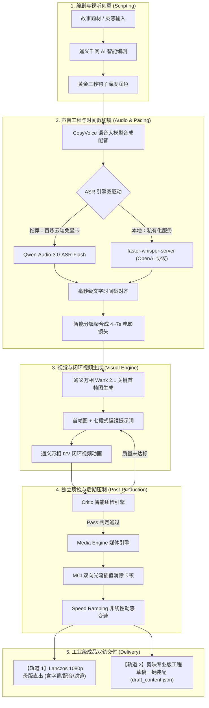

<div align="center">

# 🎬 Flow Studio Pro

**电影工业级 AI 短视频与多模态视频流一站式工作台 (融合导演引擎版)**

[](LICENSE)
[](#)
[](#)
[](#)
[](#)
[](#)

<p align="center">
  <b>融合「爆款故事写作 + 阿里百炼双向闭环 + 独立 Critic 智能质检 + 双向光流插值 + Speed Ramping 动感曲线 + 剪映/1080p 母版双轨交付」</b><br/>
  将极客级“代码化后期制作”（Code-as-Post-Production）与高直观度电影级暗黑 Web 工作台完美融合，赋能真正具备视听语言与工业美感的短视频创作。
</p>

[✨ 核心特性](#-四大核心融合模块) • [📐 架构管线](#-全流程生成管线与架构) • [🎙️ ASR 双驱动](#-语音识别与智能分镜双驱动) • [🚀 快速开始](#-极速安装与启动) • [⚙️ 配置文件](#-配置文件系统) • [📄 商业授权](#-开源许可证与商业授权)

</div>

---

## 🌟 四大核心融合模块

Flow Studio Pro 区别于市面上普通的“文本生图 ➔ 视频拼接”初级工具，我们深入视听语言与影视后期工业管线，完整实现了四大极客级融合能力：

### 1. 🛡️ 独立 Critic 智能质检引擎 (`/api/critic-inspect`)
- **解决痛点**：AI 生成的视频容易产生“面部融化”、“结构变形崩溃”、“主体动作失真”或“背景突变”。传统流程需要创作者肉眼逐个镜头检查，耗费大量精力。
- **技术原理**：
  - 自动捕获视频首尾关键帧进行像素与特征差分计算；
  - 结合提示词动力学意图，计算**语义连贯性**、**动作漂移指数**与**画面结构稳定性**；
  - 输出 0~100 综合质检置信度得分，自动标记 `Pass`（优秀）、`Warning`（轻度漂移）或 `Fail`（崩溃失败）；
  - 针对不合格切片，自动提供针对性的动力学提示词修正建议与一键重推重试指令。

### 2. 🌀 通义万相闭环 I2V 视频引擎 (`/api/animate-wanx`)
- **解决痛点**：纯文本生成视频（Text-to-Video）镜头随机性极大、人物与场景极易漂移，无法满足连续叙事的需求。
- **技术原理**：
  - 以通义万相生成的高清首帧（Text-to-Image）为绝对几何与视觉锚点；
  - 深度结合七段式运镜提示词（包含**镜头景别**、**相机运动轨迹**、**主体动态交互**与**物理动力学描述**）；
  - 原生直连阿里云百炼 **Wanx 2.1** 旗舰级模型（支持高画质旗舰版 `wanx2.1-i2v-plus` 与极速版 `wanx2.1-i2v-turbo`）；
  - 全栈异步长轮询闭环调度，生成结果自动回传至分镜流，保持叙事连贯。

### 3. 🌊 MCI 双向光流插值与 Speed Ramping 动感曲线 (`plugins/media-engine`)
- **解决痛点**：AI 生成的原始视频片段通常只有 3~5 秒固定长度，而配音台词长短不一；直接拉伸会导致卡顿跳帧，静止定格则破坏沉浸感。
- **技术原理**：
  - **MCI 运动补偿双向光流（Motion-Compensated Interpolation）**：调用 FFmpeg 底层 minterpolate 光流估计，智能预测前后帧物体的位移向量，消除画面抽搐，提升高帧率丝滑度；
  - **Speed Ramping 非线性动感变速曲线**：模拟院线大片运镜手法，采用“`前段 1.25x 爆发入场 ➔ 中段 0.8x 慢动作特写 ➔ 后段 1.25x 迅速收尾`”的呼吸感曲线，在无缝严丝合缝匹配台词绝对时长的同时，呈现极强的电影张力。

### 4. 🎬 1080p Lanczos 动感母版直出与剪映双轨交付
Flow Studio Pro 提供业内领先的**双轨并行业务交付能力**，兼顾“零门槛即时发布”与“专业级二次精剪”：
- **轨道 1：1080p 高清动感母版一键直出 (`/api/render-master`)**
  - 无需安装或打开任何第三方剪辑软件，Web 端一键生成最终成品 MP4；
  - 采用 **Lanczos 算法高保真重采样**至 1080*1920 高清竖屏；
  - 自动叠加**电影级暗角滤镜（Vignette Filter）**与色彩对比度校正；
  - 自动将配音音频精准混合并烙印**动态发光双层描边 SRT 字幕**，直接下载即可全平台发布！
- **轨道 2：剪映专业版原生工程装配 (`/api/export/jianying`)**
  - 基于 `pyJianYingDraft` 自动生成剪映官方工程草稿（`draft_content.json`）；
  - 视频轨、配音轨、多层字幕轨自动在时间轴上精准入位对齐；
  - 打开剪映电脑版即可无缝继续人工精修、加特效与商业包工。

---

## 📐 全流程生成管线与架构



---

## 🎙️ 语音识别与智能分镜双驱动

在 [`src/lib/asr.ts`](src/lib/asr.ts) 中，我们构建了业内首创的**双模 ASR 驱动架构**：

| 对比维度 | 模式 1：阿里云百炼原生 ASR (推荐) | 模式 2：faster-whisper-server |
| :--- | :--- | :--- |
| **推荐模型** | **`qwen-audio-3.0-asr-flash`** / `sensevoice-v1` | `whisper-1` / `large-v3` |
| **本地硬件门槛** | **零门槛（无需任何 GPU 显卡，普通笔记本即跑）** | 需要具备 4GB+ 显存的 NVIDIA 显卡 |
| **部署与运维** | **零部署**（自动申请百炼临时存储上传音频，异步识别） | 需要在本地安装 Python、CUDA、PyTorch 并常驻后台 |
| **凭证结算** | **直接复用同一个 `DASHSCOPE_API_KEY`，统一计费** | 自建免 Token 费用，或使用第三方代理 Key |
| **中文与标点** | 原生针对中文方言、成语、ITN 规范化深度优化 | 原版英文表现极佳，中文需额外微调 |
| **时间戳精度** | **毫秒级**（`begin_time` / `end_time`） | **秒级浮点**（`segments[].start` / `end`） |

> 💡 **切换方式**：直接在工作台右上角 **设置图标 ⚙️** 中下拉切换，或在 `studio_config.js` 中将 `asr.provider` 设为 `"dashscope_asr"` 或 `"faster_whisper"` 即可！

---

## 🛠️ 本地工具与环境依赖说明

Flow Studio Pro 主体为 **Next.js 纯全栈单体架构**。我们对环境依赖实施了**“按需渐进式解耦”**：

| 依赖组件 | 必须程度 | 核心用途 | 安装方式 / 快捷命令 |
| :--- | :---: | :--- | :--- |
| **Node.js 18+ 或 20+** | **必需** | 驱动整套全栈工作台、Web 界面渲染与 API 调度 | [nodejs.org 官网下载安装](https://nodejs.org/) |
| **Python 3.10+** | **可选插件** | 驱动 `pyJianYingDraft` 剪映草稿装配及复杂媒体算法 | 安装 Python 并勾选 Add to PATH，执行：`pip install -r requirements.txt` |
| **FFmpeg 5.0+** | **可选插件** | 驱动双向光流插值、Speed Ramping 与 1080p 母版直出 | Windows (管理员 PowerShell): `winget install Gyan.FFmpeg`<br>macOS: `brew install ffmpeg` |

> 💡 **新手免配置说明**：即使本地不安装 Python 和 FFmpeg，基础的核心功能（AI 编剧、百炼 CosyVoice 配音、百炼 ASR 智能切镜、万相首帧生图、Wanx 2.1 闭环 I2V 视频）**依然 100% 能够独立完整运行**！

---

## 🚀 极速安装与启动

### 方式 1：一键全自动检测安装（推荐）

- **Windows 本机用户**：
  直接双击运行根目录下的 **`setup.bat`**。
  *(脚本已采用原生 ANSI 编码与扁平化控制流，杜绝任何语法冲突或乱码，自动完成环境检测、npm 依赖安装与配置文件就绪)*。
- **macOS / Linux 用户**：
  在终端中执行：
  ```bash
  chmod +x setup.sh start.sh
  ./setup.sh
  ```

### 方式 2：命令行手动部署

#### 1. 安装前端 Web 依赖
```bash
npm install
```

#### 2. (可选) 安装 Python 插件依赖
若需使用剪映草稿导出功能：
```bash
pip install -r requirements.txt
```

#### 3. 配置服务密钥（三选一）
- **方式 A（推荐可视化）**：直接启动工作台，在浏览器右上角点击 **设置图标 ⚙️** 输入你的百炼 API Key，点击保存即可立即生效。
- **方式 B（JS 配置文件）**：复制 `studio_config.template.js` 为 `studio_config.js` 并填入密钥。
- **方式 C（环境变量）**：复制 `.env.example` 为 `.env`：
  ```bash
  cp .env.example .env
  ```

#### 4. 启动工作台
- **双击脚本**：运行 `start.bat`（Windows）或 `./start.sh`（macOS/Linux）
- **命令行启动**：
  ```bash
  npm run dev
  ```
启动后打开浏览器访问：**[http://localhost:3000](http://localhost:3000)**。

---

## ⚙️ 配置文件系统 (`studio_config.js`)

系统优先支持携带丰富注释的 JavaScript 配置文件 [`studio_config.js`](studio_config.js)：

```javascript
module.exports = {
  // 1. 阿里云百炼 (DashScope) 核心配置
  dashscope: {
    api_key: process.env.DASHSCOPE_API_KEY || "sk-xxxxxxxxxxxxxxxxxxxxxxxx",

    // CosyVoice 语音大模型
    tts: {
      model: "cosyvoice-v1",
      voice: "longxiaochun", // 龙小淳 (叙事) / 龙华 (沉稳史诗) / 龙婉 (深情)
      speech_rate: 1.05,
    },

    // 通义万相首帧生图
    image: {
      model: "wanx-2.1-t2i-turbo",
      size: "720*1280",       // 9:16 短视频竖屏
    },

    // 通义万相 I2V 闭环生视频
    video: {
      model: "wanx2.1-i2v-plus", // 旗舰版 "wanx2.1-i2v-plus" / 极速版 "wanx2.1-i2v-turbo"
      resolution: "720p",
      prompt_extend: false,
    },
  },

  // 2. 语音识别与分镜对齐驱动
  asr: {
    // "dashscope_asr" (推荐百炼云端) 或 "faster_whisper" (本地服务)
    provider: process.env.ASR_PROVIDER || "dashscope_asr",
    dashscope_model: "qwen-audio-3.0-asr-flash",
    endpoint_url: "http://127.0.0.1:8000/v1/audio/transcriptions",
  },

  // 3. 视觉分镜时长编排节奏
  pacing: {
    target_shot_duration_sec: 5.5, // 推荐单镜头时长 (秒)
    fallback_mode: "hybrid_image", // 2.5D 图片推拉兜底
  },

  // 4. 插件系统
  plugins: {
    jianying_draft: {
      enabled: true,
      python_path: "python",
    },
  },
};
```

---

## 📁 项目目录结构

```text
├── docs/                             # 架构方案与开发规划设计
│   ├── ARCHITECTURE_AND_PLAN.md      # 导演引擎全套架构契约
│   └── DEVELOPMENT_PLAN.md           # 5 大开发阶段与里程碑规划
├── plugins/                          # 核心后期媒体插件库
│   ├── jianying-draft/               # 剪映专业版草稿生成器 (export.py)
│   └── media-engine/                 # FFmpeg 光流变速与母版压制核心引擎 (engine.py)
├── src/                              # Next.js 14 App Router 全栈源码
│   ├── app/
│   │   ├── api/
│   │   │   ├── animate-wanx/         # 万相闭环 I2V 视频异步生成接口
│   │   │   ├── asr/                  # ASR 毫秒级对齐与智能分镜接口
│   │   │   ├── config/               # 配置读取与可视化热更新接口
│   │   │   ├── critic-inspect/       # 独立 Critic 智能质检差分计算接口
│   │   │   ├── export/jianying/      # 剪映草稿工程导出接口
│   │   │   ├── generate-script/      # 通义千问爆款故事智能生成接口
│   │   │   ├── render-master/        # 1080p Lanczos 动感母版直出接口
│   │   │   ├── rewrite-hook/         # 黄金三秒爆款钩子重写接口
│   │   │   ├── tts/                  # CosyVoice 语音大模型配音接口
│   │   │   └── wanx/                 # 通义万相高清首帧生图接口
│   │   ├── layout.tsx                # 全局布局与字体注入
│   │   └── page.tsx                  # 导演工作台核心交互主界面
│   ├── lib/
│   │   ├── asr.ts                    # ASR 双驱动核心实现 (百炼+Whisper)
│   │   ├── config.ts                 # 动态配置中心与环境变量解析器
│   │   ├── dashscope.ts              # 阿里云百炼多模态 SDK 客户端封装
│   │   ├── pacing.ts                 # 电影视听语言 4~7s 智能分镜聚合算法
│   │   └── prompts.ts                # 爆款故事、Writing-DNA 与运镜提示词库
│   ├── types/                        # TypeScript 严谨强类型契约
│   └── styles/                       # 电影暗黑视觉主题样式
├── .env.example                      # 环境变量配置模板
├── studio_config.js                  # 核心 JS 配置文件 (支持丰富注释)
├── requirements.txt                  # Python 扩展依赖清单
├── setup.bat / setup.sh              # 跨平台一键自检与依赖安装脚本
├── start.bat / start.sh              # 跨平台一键启动脚本
└── package.json
```

---

## 📄 开源许可证与商业授权

- **开源版本协议**：本项目开源代码严格遵守 **[GNU Affero General Public License v3.0 (AGPL-3.0)](LICENSE)** 协议。在 AGPL-3.0 协议下，任何修改、衍生版本或通过网络（SaaS）向公众提供服务的产品均必须完整开源其专有业务源码。
- **商业授权 (Commercial License)**：如果您希望在企业内部闭源商用、集成入私有商业化产品、作为专有商业 SaaS 运营或免除 AGPL-3.0 强制开源义务，请联系我们获取专有的商业免开源许可授权。
