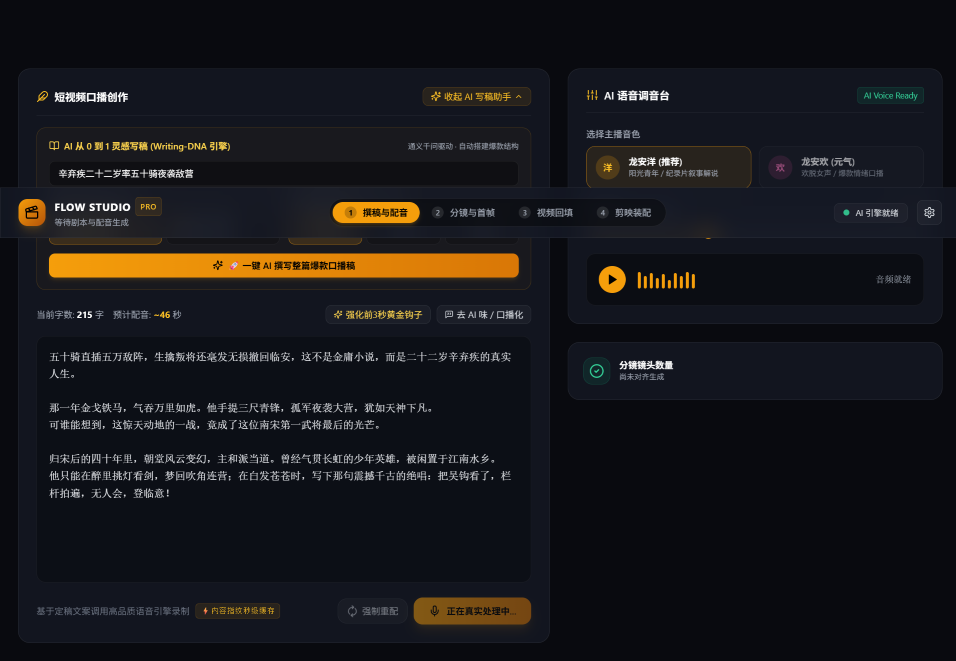
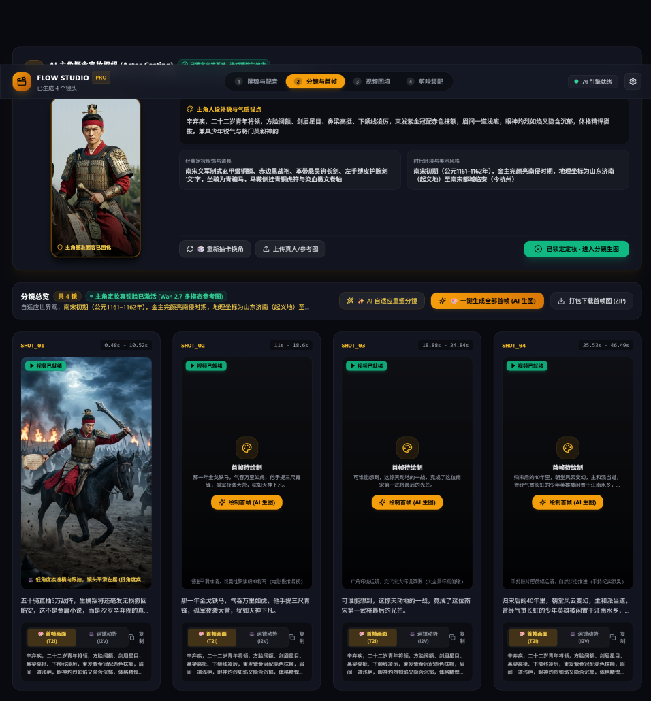
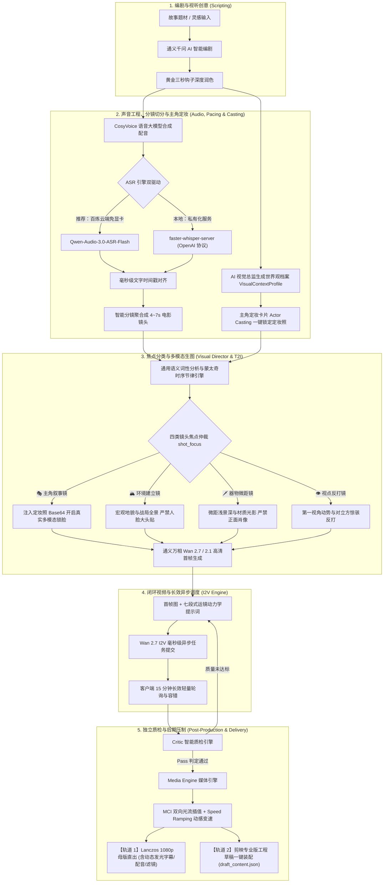

<div align="center">

# 🎬 Flow Studio Pro

**电影工业级 AI 短视频与多模态视频流一站式工作台 (融合导演引擎版)**

[](LICENSE)
[](#)
[](#)
[](#)
[](#)
[](#)

<p align="center">
  <b>融合「爆款故事写作 + 主角定妆锁脸 + 跨题材语义镜头节律 + 阿里百炼双向闭环 + 独立 Critic 智能质检 + 双向光流插值 + Speed Ramping 动感曲线 + 剪映/1080p 母版双轨交付」</b><br/>
  将极客级“代码化后期制作”（Code-as-Post-Production）与高直观度电影级暗黑 Web 工作台完美融合，赋能真正具备视听语言与工业美感的短视频创作。
</p>

[📸 界面预览](#-工作台界面预览-demo) • [✨ 核心特性](#-六大核心融合模块) • [📐 架构管线](#-全流程生成管线与架构) • [🎙️ ASR 双驱动](#-语音识别与智能分镜双驱动) • [🚀 快速开始](#-极速安装与启动) • [⚙️ 配置文件](#-配置文件系统) • [📄 商业授权](#-开源许可证与商业授权)

</div>

---

## 📸 工作台界面预览 (Demo)

### 步骤一：故事编剧、CosyVoice 配音与主角定妆 (Actor Casting)
<div align="center">
  
  <p><i>图 1：爆款故事生成、黄金三秒钩子深度润色、毫秒级 CosyVoice 配音合成与主角定妆锁脸卡片</i></p>
</div>

### 步骤二：电影级分镜编排、焦点自适应识别与闭环视频就绪
<div align="center">
  
  <p><i>图 2：跨题材通用语义焦点识别（🎭主角 / 🏔️环境 / 🗡️器物 / 👁️视点）、按需真实锁脸生图与 5 分钟异步长效视频生成流</i></p>
</div>

---

## 🌟 六大核心融合模块

Flow Studio Pro 区别于市面上普通的“文本生图 ➔ 视频拼接”初级工具，我们深入视听语言与影视后期工业管线，完整实现了六大极客级融合能力：

### 1. 🎭 主角定妆 (Actor Casting) 与 Wan 2.7 真实多模态锁脸
- **解决痛点**：传统 AI 视频由于分镜之间人物面貌随机漂移，生成的短片往往“一镜换一张脸”，缺乏连续剧和电影的连戏感。
- **技术原理**：
  - **主角定妆卡片 (Actor Casting)**：在脚本和配音就绪后，基于全局世界观智能提取主角锚点（如“二十二岁青年将领，方脸阔额、剑眉星目、赤色抹额”），一键渲染并由创作者锁定核心角色定妆图；
  - **Wan 2.7 真实多模态生图**：适配通义万相新一代 `wan2.7-image` 多模态接口，将锁定定妆图以 Base64 编码作为真实视觉参考图（`<img_prompt_1>`）传入生图模型，实现业界领先的真实物理级锁脸连戏；
  - **全局世界观设定档案 (`VisualContextProfile`)**：深度约束时代背景、服饰器物、艺术风格与负向排斥护栏，从根源杜绝画风崩坏。

### 2. 🎬 电影级镜头焦点 (Cinematic Shot Focus) 与跨题材语义引擎
- **解决痛点**：若全片每一个分镜都硬塞主角定妆大头贴，不仅严重破坏电影镜头呼吸感（有大有小、有人有物），还会导致远景大军、宏观地貌与微观器物失真。
- **技术原理**：
  - **四类镜头焦点智能划分**：
    - 🎭 **主角叙事镜 (`character`)**：主角核心动作与情绪特写，**仅此类镜头接入定妆图多模态参考**；
    - 🏔️ **环境建立镜 (`environment`)**：大阵仗、战争营地与时代宏观空间，严禁人脸大头贴；
    - 🗡️ **器物微距镜 (`prop`)**：兵刃符印、手稿信件、芯片主板微距特写，浅景深虚化；
    - 👁️ **视点/对抗镜 (`pov_antagonist`)**：第一人称疾驰穿梭与敌军惊骇动势；
  - **跨题材自适应通用语义识别**：全面摆脱对特定朝代名词的死板正则，采用通用的物理名词、触感动词、宏观地貌与微表情词性多因子打分算法，无缝兼容**古代历史、民国传奇、现代商战、科技创业、科幻废土**等全题材；
  - **电影蒙太奇时序节律 (Temporal Pacing Bias)**：融入 Establishing Shot 首镜空间建立、Anti-Character Fatigue 防连续主角疲劳平滑切出机制。

### 3. 🌀 通义万相闭环 I2V 视频引擎与 15 分钟长效异步调度 (`/api/animate-wanx`)
- **解决痛点**：高画质长视频生成耗时通常在 3~5 分钟以上，极易遭遇网关 504 Gateway Timeout 或连接断开崩溃。
- **技术原理**：
  - **毫秒级异步提交 + 客户端长效轻量轮询**：接口采用轻量异步提交立即返回 `task_id`，配合前端 15 分钟长效重试容错与指数退避轮询，彻底告别超时阻断；
  - **Wan 2.7 I2V 视频管线闭环**：以高清首帧为绝对几何锚点，深度结合七段式运镜动力学提示词，原生直连阿里云百炼 `Wan2.7-I2V` 与 `wanx2.1-i2v-plus` 旗舰级模型；
  - **智能缓存复用与状态持久化**：基于提示词内容哈希（SHA-256）自动复用已有渲染切片，杜绝资源浪费。

### 4. 🛡️ 独立 Critic 智能质检引擎 (`/api/critic-inspect`)
- **解决痛点**：AI 生成的视频容易产生“面部融化”、“结构变形崩溃”或“画面突变”。传统流程需要人工逐镜肉眼排查。
- **技术原理**：
  - 自动捕获视频首尾关键帧进行像素与特征差分计算；
  - 结合提示词动力学意图，计算**语义连贯性**、**动作漂移指数**与**画面结构稳定性**；
  - 输出 0~100 综合质检置信度得分，自动标记 `Pass`、`Warning` 或 `Fail`；
  - 针对不合格切片，自动提供动力学提示词修正建议与一键重试指令。

### 5. 🌊 MCI 双向光流插值与 Speed Ramping 动感曲线 (`plugins/media-engine`)
- **解决痛点**：AI 生成的原始视频片段通常只有 3~5 秒固定长度，而配音台词长短不一；直接拉伸会导致卡顿跳帧。
- **技术原理**：
  - **MCI 运动补偿双向光流（Motion-Compensated Interpolation）**：调用 FFmpeg 底层 `minterpolate` 光流估计，智能预测前后帧位移向量，消除画面抽搐；
  - **Speed Ramping 非线性动感变速曲线**：模拟院线大片“`前段 1.25x 爆发入场 ➔ 中段 0.8x 慢动作特写 ➔ 后段 1.25x 迅速收尾`”，严丝合缝匹配台词时长，呈现极强视听张力。

### 6. 🎬 1080p Lanczos 动感母版直出与剪映双轨交付
Flow Studio Pro 提供业内领先的**双轨并行业务交付能力**：
- **轨道 1：1080p 高清动感母版一键直出 (`/api/render-master`)**
  - Web 端一键生成最终成品 MP4，采用 **Lanczos 算法高保真重采样**至 1080*1920 高清竖屏；
  - 自动叠加**电影级暗角滤镜（Vignette Filter）**与色彩对比度校正；
  - 精准混合配音音频并烙印**动态发光双层描边 SRT 字幕**，直接下载即可全平台发布！
- **轨道 2：剪映专业版原生工程装配 (`/api/export/jianying`)**
  - 基于 `pyJianYingDraft` 自动生成剪映官方工程草稿（`draft_content.json`）；
  - 视频轨、配音轨、多层字幕轨自动在时间轴上精准入位对齐，无缝对接二次精剪。

---

## 📐 全流程生成管线与架构



---

## 🎙️ 语音识别与智能分镜双驱动

在 [`src/lib/asr.ts`](src/lib/asr.ts) 中，我们构建了业内首创的**双模 ASR 驱动架构**：

| 对比维度 | 模式 1：阿里云百炼原生 ASR (推荐) | 模式 2：faster-whisper-server |
| :--- | :--- | :--- |
| **推荐模型** | **`qwen-audio-3.0-asr-flash`** / `sensevoice-v1` | `whisper-1` / `large-v3` |
| **本地硬件门槛** | **零门槛（无需任何 GPU 显卡，普通笔记本即跑）** | 需要具备 4GB+ 显存的 NVIDIA 显卡 |
| **部署与运维** | **零部署**（自动申请百炼临时存储上传音频，异步识别） | 需要在本地安装 Python、CUDA、PyTorch 并常驻后台 |
| **凭证结算** | **直接复用同一个 `DASHSCOPE_API_KEY`，统一计费** | 自建免 Token 费用，或使用第三方代理 Key |
| **中文与标点** | 原生针对中文方言、成语、ITN 规范化深度优化 | 原版英文表现极佳，中文需额外微调 |
| **时间戳精度** | **毫秒级**（`begin_time` / `end_time`） | **秒级浮点**（`segments[].start` / `end`） |

> 💡 **切换方式**：直接在工作台右上角 **设置图标 ⚙️** 中下拉切换，或在 `studio_config.js` 中将 `asr.provider` 设为 `"dashscope_asr"` 或 `"faster_whisper"` 即可！

---

## 🛠️ 本地工具与环境依赖说明

Flow Studio Pro 主体为 **Next.js 纯全栈单体架构**。我们对环境依赖实施了**“按需渐进式解耦”**：

| 依赖组件 | 必须程度 | 核心用途 | 安装方式 / 快捷命令 |
| :--- | :---: | :--- | :--- |
| **Node.js 18+ 或 20+** | **必需** | 驱动整套全栈工作台、Web 界面渲染与 API 调度 | [nodejs.org 官网下载安装](https://nodejs.org/) |
| **Python 3.10+** | **可选插件** | 驱动 `pyJianYingDraft` 剪映草稿装配及复杂媒体算法 | 安装 Python 并勾选 Add to PATH，执行：`pip install -r requirements.txt` |
| **FFmpeg 5.0+** | **可选插件** | 驱动双向光流插值、Speed Ramping 与 1080p 母版直出 | Windows (管理员 PowerShell): `winget install Gyan.FFmpeg`<br>macOS: `brew install ffmpeg` |

> 💡 **新手免配置说明**：即使本地不安装 Python 和 FFmpeg，基础的核心功能（AI 编剧、百炼 CosyVoice 配音、百炼 ASR 智能切镜、万相首帧生图、Wanx 2.1 闭环 I2V 视频）**依然 100% 能够独立完整运行**！

---

## 🚀 极速安装与启动

### 方式 1：一键全自动检测安装（推荐）

- **Windows 本机用户**：
  直接双击运行根目录下的 **`setup.bat`**。
  *(脚本已采用原生 ANSI 编码与扁平化控制流，杜绝任何语法冲突或乱码，自动完成环境检测、npm 依赖安装与配置文件就绪)*。
- **macOS / Linux 用户**：
  在终端中执行：
  ```bash
  chmod +x setup.sh start.sh
  ./setup.sh
  ```

### 方式 2：命令行手动部署

#### 1. 安装前端 Web 依赖
```bash
npm install
```

#### 2. (可选) 安装 Python 插件依赖
若需使用剪映草稿导出功能：
```bash
pip install -r requirements.txt
```

#### 3. 配置服务密钥（三选一）
- **方式 A（推荐可视化）**：直接启动工作台，在浏览器右上角点击 **设置图标 ⚙️** 输入你的百炼 API Key，点击保存即可立即生效。
- **方式 B（JS 配置文件）**：复制 `studio_config.template.js` 为 `studio_config.js` 并填入密钥。
- **方式 C（环境变量）**：复制 `.env.example` 为 `.env`：
  ```bash
  cp .env.example .env
  ```

#### 4. 启动工作台
- **双击脚本**：运行 `start.bat`（Windows）或 `./start.sh`（macOS/Linux）
- **命令行启动**：
  ```bash
  npm run dev
  ```
启动后打开浏览器访问：**[http://localhost:3000](http://localhost:3000)**。

---

## ⚙️ 配置文件系统 (`studio_config.js`)

系统优先支持携带丰富注释的 JavaScript 配置文件 [`studio_config.js`](studio_config.js)，支持通过 Web 界面右上角设置弹窗**热更新**（已内置安全掩码脱敏保护，防止密钥明文泄露）：

```javascript
module.exports = {
  // 1. 阿里云百炼 (DashScope) 核心配置
  dashscope: {
    api_key: process.env.DASHSCOPE_API_KEY || "sk-xxxxxxxxxxxxxxxxxxxxxxxx",

    // CosyVoice 语音大模型
    tts: {
      model: "cosyvoice-v1",
      voice: "longanyang",    // 龙昂扬 (官方推荐叙事) / 龙安欢 (深情自然)
      speech_rate: 1.05,
    },

    // 通义万相首帧与定妆生图 (支持 Wan 2.7 与 2.1)
    image: {
      model: "wan2.7-image",  // 推荐新一代 "wan2.7-image" (支持多模态参考生图) 或 "wanx2.1-t2i-turbo"
      size: "720*1280",       // 9:16 短视频竖屏
    },

    // 通义万相 I2V 闭环生视频 (支持 Wan 2.7 与 2.1)
    video: {
      model: "Wan2.7-I2V",    // 推荐 "Wan2.7-I2V" 或旗舰版 "wanx2.1-i2v-plus" / 极速版 "wanx2.1-i2v-turbo"
      resolution: "720p",
      prompt_extend: false,
    },
  },

  // 2. 语音识别与分镜对齐驱动
  asr: {
    // "dashscope_asr" (推荐百炼云端) 或 "faster_whisper" (本地服务)
    provider: process.env.ASR_PROVIDER || "dashscope_asr",
    dashscope_model: "qwen-audio-3.0-asr-flash",
    endpoint_url: "http://127.0.0.1:8000/v1/audio/transcriptions",
  },

  // 3. 视觉分镜时长编排节奏
  pacing: {
    target_shot_duration_sec: 5.5, // 推荐单镜头时长 (秒)
    fallback_mode: "hybrid_image", // 2.5D 图片推拉兜底
  },

  // 4. 插件系统
  plugins: {
    jianying_draft: {
      enabled: true,
      python_path: "python",
    },
  },
};
```

---

## 📁 项目目录结构

```text
├── docs/                             # 架构方案、开发规划与产品原型截图
│   ├── prototype/                    # 完整运行截图 (第一步定妆与第二步分镜焦点)
│   │   ├── localhost_3000_1.png      # 步骤一：故事生成、配音与主角定妆
│   │   └── localhost_3000_2.png      # 步骤二：分镜编排、焦点分类与首帧流
│   ├── ARCHITECTURE_AND_PLAN.md      # 导演引擎全套架构契约
│   └── DEVELOPMENT_PLAN.md           # 5 大开发阶段与里程碑规划
├── plugins/                          # 核心后期媒体插件库
│   ├── jianying-draft/               # 剪映专业版草稿生成器 (export.py)
│   └── media-engine/                 # FFmpeg 光流变速与母版压制核心引擎 (engine.py)
├── src/                              # Next.js 14 App Router 全栈源码
│   ├── app/
│   │   ├── api/
│   │   │   ├── animate-wanx/         # 万相闭环 I2V 视频 15 分钟长效异步调度
│   │   │   ├── asr/                  # ASR 毫秒级对齐与智能分镜接口
│   │   │   ├── character-casting/    # 主角定妆图生成与肖像锁定接口
│   │   │   ├── config/               # 配置读取与带掩码热更新接口
│   │   │   ├── critic-inspect/       # 独立 Critic 智能质检差分计算接口
│   │   │   ├── export/jianying/      # 剪映草稿工程导出接口
│   │   │   ├── generate-script/      # 通义千问爆款故事智能生成接口
│   │   │   ├── render-master/        # 1080p Lanczos 动感母版直出接口
│   │   │   ├── rewrite-hook/         # 黄金三秒爆款钩子重写接口
│   │   │   ├── tts/                  # CosyVoice 语音大模型配音接口
│   │   │   ├── visual-director/      # 视觉设定档案与分镜智能扩充接口
│   │   │   └── wanx/                 # 通义万相高清首帧与多模态锁脸生图
│   │   ├── layout.tsx                # 全局布局与字体注入
│   │   └── page.tsx                  # 导演工作台核心交互主界面
│   ├── components/                   # UI 组件库 (分镜流、定妆卡、质检弹窗等)
│   ├── lib/
│   │   ├── asr.ts                    # ASR 双驱动核心实现 (百炼+Whisper)
│   │   ├── config.ts                 # 动态配置中心与环境变量解析器
│   │   ├── dashscope.ts              # 阿里云百炼多模态 SDK 客户端封装
│   │   ├── pacing.ts                 # 电影视听语言 4~7s 智能分镜聚合算法
│   │   ├── prompts.ts                # 爆款故事、Writing-DNA 与运镜提示词库
│   │   └── visualDirector.ts         # 通用语义词性分析与蒙太奇时序节律引擎
│   ├── types/                        # TypeScript 严谨强类型契约
│   └── styles/                       # 电影暗黑视觉主题样式
├── .env.example                      # 环境变量配置模板
├── studio_config.js                  # 核心 JS 配置文件 (支持丰富注释)
├── requirements.txt                  # Python 扩展依赖清单
├── setup.bat / setup.sh              # 跨平台一键自检与依赖安装脚本
├── start.bat / start.sh              # 跨平台一键启动脚本
└── package.json
```

---

## 📄 开源许可证与商业授权

- **开源版本协议**：本项目开源代码严格遵守 **[GNU Affero General Public License v3.0 (AGPL-3.0)](LICENSE)** 协议。在 AGPL-3.0 协议下，任何修改、衍生版本或通过网络（SaaS）向公众提供服务的产品均必须完整开源其专有业务源码。
- **商业授权 (Commercial License)**：如果您希望在企业内部闭源商用、集成入私有商业化产品、作为专有商业 SaaS 运营或免除 AGPL-3.0 强制开源义务，请联系我们获取专有的商业免开源许可授权。
