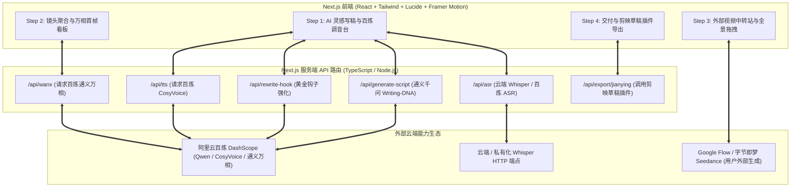

# Flow Studio Pro · 电影工业级真实视频流工作台
## 系统架构与全套落地方案 (Next.js 纯全栈版)

---

## 1. 架构定位与设计哲学

本工作台专注于解决长篇故事口播与短视频制作中“静态图片死板推拉”与“多工具割裂切换”的痛点，构建了一套标准化、工程化的 **I2V (Image-to-Video) 真实视频流水线**：

1. **全链路云端生态，解耦重算力**：
   - **文案与钩子重塑**：阿里云百炼通义千问 `qwen-plus` 深度注入爆款 Writing-DNA；
   - **TTS**：阿里云百炼语音大模型（CosyVoice 系列 / Sambert 系列）通过 DashScope HTTP API 调用；
   - **ASR 对齐**：兼容 OpenAI 规范的云端 Whisper 或自建私有化端点，毫秒级字戳提取；
   - **首帧图生成**：阿里云百炼通义万相 API（`wanx-2.1-t2i-turbo` / `wanx-v1`）生成 9:16 高清考据图，锁定人物角色与画风一致性。
2. **Next.js 纯全栈单体架构**：
   - 彻底告别双端多端口维护，所有服务端业务逻辑（请求百炼、分镜聚合计算、提示词生成、素材管理）全部由 **Next.js App Router API 路由** 统一使用 TypeScript 承载；
   - 本地仅需一条 `npm run dev`，即可跑起整套生产级工作台。
3. **剪映草稿能力“插件化（Pluggable Exporter）”**：
   - 剪映工程生成仅作为工作流最后一环的可选插件（存放于 `plugins/jianying-draft/`）；
   - 如果用户未配置 Python 或无需剪映，系统依然提供通用工程数据包与时间轴清单，不阻碍主视频生产流。

---

## 2. 纯全栈端到端流水线

---

## 3. 插件化剪映设计规范 (`plugins/jianying-draft`)

剪映草稿导出被设计为松耦合的可插拔适配器：

1. **前端契约**：点击“导出草稿”时，前端提交当前工程完整的 `resolved_project.json`（含时间轴、配音路径、字幕、视频片段与图片映射）；
2. **插件执行**：
   - Next.js 调用 `plugins/jianying-draft/export.py` 执行最终写入；
   - 包含自适应时长策略（长截取、微短慢放、极短末帧冻结、无视频镜头静态图推拉垫底）；
3. **容错机制**：如果宿主环境缺少 Python 或 `pyJianYingDraft`，工作台优雅降级，提供时间轴与素材数据，让用户可手动导入任意剪辑软件。
